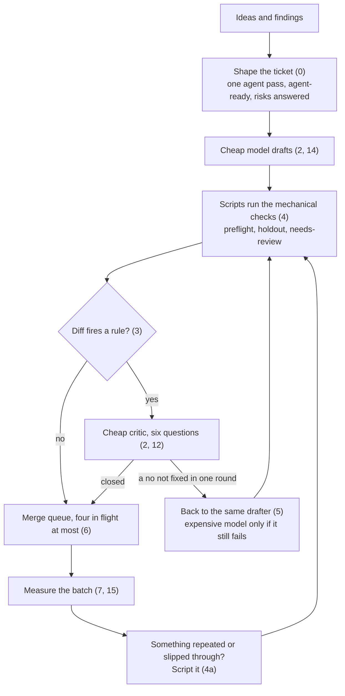

<picture>
  <source media="(prefers-color-scheme: dark)" srcset="assets/logo-dark.svg">
  
</picture>

# Lean agent

Run AI coding agents over a ticket backlog without burning a plan in a night.

[](https://github.com/arnelirobles/lean-agent/releases) [](https://github.com/arnelirobles/lean-agent/actions/workflows/ci.yml) [](LICENSE)

Lean agent is a method and a Claude Code plugin. The method is how I ran agents over my own backlog after burning through a plan in one night in September 2026. The plugin is the part of the method that runs by itself: skills, scripts on the agent's PATH, and hooks that block or note.

The numbers here are mine, at list prices, on one .NET codebase. Treat them as a shape, not a benchmark.

## The short version

Shape the ticket for the agent before anyone starts: one ticket is one agent pass, written so the agent needs nothing else, with the review's questions answered in advance. A cheaper model drafts every change, and a fast one finds code and runs the gates. Scripts, not instructions, run the mechanical checks. A cheap critic reviews every change against six fixed questions. The expensive model only sees what the critic cannot close. At most four changes in flight.

That took me from about 13 dollars of model use per change to about 9, with no drop in what got caught. Until 1.4.0 this line said 66 and 25: the cost script counted each message's usage once per transcript row, and its prices were those of older models. [Section 7](https://github.com/arnelirobles/lean-agent/wiki/Measure-Every-Batch) has the correction.



The numbers in brackets are sections of the method. Each one is a page in the [wiki](https://github.com/arnelirobles/lean-agent/wiki/Home).

## Why three models

Each step goes to the cheapest model that can do it without losing a defect.

| Model | Runs | List price per million tokens, in and out |
| --- | --- | --- |
| Haiku (fast) | finding code, running the gates and pasting their output, collecting the retro's numbers | 0.10 and 0.50 |
| Sonnet (cheap) | spec review, every draft, the critic's hunt and refute, the first fix round | 2 and 10 |
| Opus (strong) | a finding not fixed in one round, an unsure answer on core code | 4 and 20 |

Haiku is 20 times cheaper than Sonnet and faster, so work that only reads and reports costs almost nothing. It never answers a yes or no about code. A small model that wrongly throws out a finding drops a real defect with no trace, so the critic stays on Sonnet.

What this saves depends on how much of a change's cost was searching and running scripts. Most of it is the draft and the critic, which do not move. The Haiku split has not been measured on a batch yet. Run `lean-stats report` after one: it prints cost by role, and `search`, `gate` and `retro` are the Haiku roles. If they stay under a few percent of the spend, the saving is small and `LEAN_MODEL_FAST=sonnet` changes nothing that matters.

## Install

```bash
claude plugin marketplace add arnelirobles/lean-agent
claude plugin install lean-agent@lean-agent
```

Update with `claude plugin update lean-agent@lean-agent`. Claude Code picks up a change only when the plugin version moves. More in [Installation](https://github.com/arnelirobles/lean-agent/wiki/Installation).

## What you get

| Part | What it does | Reference |
| --- | --- | --- |
| `method` skill | The condensed rules. The agent loads it when it plans, files, reviews or finishes a batch. You do not call it. | [The cascade](https://github.com/arnelirobles/lean-agent/wiki/The-Cascade) |
| `/lean-agent:shape-ticket` | Writes an issue in the agent-ready shape, after searching for one it belongs to. | [Shape the ticket](https://github.com/arnelirobles/lean-agent/wiki/Shape-the-Ticket) |
| `/lean-agent:adversarial-review` | The critic: one agent hunts, a second tries to refute. | [Adversarial critic](https://github.com/arnelirobles/lean-agent/wiki/Adversarial-Critic) |
| `/lean-agent:lean-retro` | The retro that changes the method from numbers. | [Self-improving retro](https://github.com/arnelirobles/lean-agent/wiki/Self-Improving-Retro) |
| Scripts in `bin/` | Preflight, holdout, needs-review, cost, hygiene and more, on the agent's PATH. Each has a `--self-test`. | [Scripts](https://github.com/arnelirobles/lean-agent/wiki/Scripts) |
| `test-phase` | Drains the test queue in brain through `heavy.sh` with a stall watchdog, one drainer at a time. Takes a plan file too (one project per line). Sorts failures into flaky and real, logs every command as a run, and writes the failures to brain. | [The cycle](#the-cycle) |
| `brain` | A local SQLite list of open failures, deferred minors, questions, blockers, running agents and next steps, plus the test queue, with tags, runs and stats. `brain resume` prints what is open for a project, and `brain digest` a 2 KB summary of it (counts, blockers, questions, running jobs, stale agents). | [The cycle](#the-cycle) |
| `brain-mcp` | An MCP server (the plugin registers it as `brain`) that gives a session eleven tools over the brain database: `brain_list` (open items, newest first, 50 lines unless `limit` says otherwise), `brain_show`, `brain_add`, `brain_close`, `brain_queue_list` (queued and running unless `status` says otherwise), `brain_queue_add`, `brain_queue_cancel`, `brain_queue_bump`, `brain_queue_route`, `brain_digest` and `brain_stats`. It runs the `brain` CLI, sends a body on stdin, and does not expose `queue next` or `queue finish`, which only the drainer uses. | [The cycle](#the-cycle) |
| `vscode/` | The Lean Brain VS Code extension: a read-only dashboard, status bar and trees over the brain database. Build it with `npm run package` in `vscode/`. | [vscode/README.md](vscode/README.md) |
| Hooks | Three block (attribution and slop in public text, a bad commit author, files in a scratchpad root). The rest add a note and never stop the call. One of them hands the session a brain digest for its project at startup and after a compaction. Each has an off switch. | [Hooks](https://github.com/arnelirobles/lean-agent/wiki/Hooks) |
| `lean-stats` | One local SQLite file of tokens, reviews, merges and hook fires. Nothing leaves the machine. | [Measure every batch](https://github.com/arnelirobles/lean-agent/wiki/Measure-Every-Batch) |

Everything in the method still works without the plugin. Without it, run the scripts from `bin/` (for example `bin/holdout.sh`).

## The cycle

Code everything first, with builds only. Then run one test phase, load balanced. Failures go to brain. Then one fix round.

```bash
brain queue add ~/repos/app tests/App.Tests/App.Tests.csproj --cycle c1 --by me   # prints the job id
brain queue add ~/repos/app tests/Api.Tests/Api.Tests.csproj --after 1 --cycle c1
test-phase                     # drains the queue; start it once, as a background task
test-phase plan.txt            # same, after enqueuing the plan (<repo-dir> <test project path> [fast-filter])
brain list --cycle c1          # what the phase found
brain list --open              # what the fix round works from
brain close 12 --resolution fixed --commit abc1234
test-phase                     # again, to see the list empty
brain stats                    # flaky rate, lane wait and duration per test project
```

The plugin's `bin` directory is on PATH, so these run by name. Without that (older Claude Code, a plain shell), run them from the plugin's `bin` directory.

Nobody waits in a loop. A session adds jobs with `brain queue add` (it returns at once) and ends its turn. The orchestrator starts one `test-phase` as a background task and gets one notice when it exits. `test-phase` takes the oldest job whose `--after` job is done, runs it, records the run and the failures, and repeats until nothing is ready. A second `test-phase` while one drains says so and exits 0. A job whose dependency failed or was cancelled is cancelled with the reason. `brain queue list` and `brain resume` show queued and running jobs; `brain queue cancel ID` drops a queued one. `brain queue bump ID` moves a queued job, and the queued jobs chained after it with `--after`, to the front; the last one bumped runs first, and the list marks bumped jobs `bumped`. `brain queue move ID up` or `down` swaps a queued job with its neighbour in run order, and refuses to put a job ahead of the job it waits on. `brain queue list --status queued` lists jobs in the order they will run. Adding a job that is already queued (same folder, project, filter, tier, `--after` and arguments) prints the queued job's id instead of adding a second, so agents that ask for the same run share one build. A fast filter can name several classes joined by `|`, for example `--filter 'OrderTests|InvoiceTests'`; test-phase passes one `--filter-class` per class under MTP (xunit v3 runs the union of repeated ones) and one `FullyQualifiedName~` term per class under VSTest. Under MTP it then lists each class alone, and a class that matches no test fails the job and is named, since the union hides it while another class matches.

Remote lanes: list SSH hosts in `~/.config/lean/remotes.ini` and `test-phase` runs one job per host at the same time as the local lane, in a capped docker container on the host. Apple-platform test projects stay local. A lost connection puts the job back in the queue, not in brain as a failure. The host keeps one build folder per repository, commit, hash of the copied files and contents, image and build arguments: the first job on that key copies and builds, later jobs skip both and run `dotnet test --no-build` there, and a new commit or any changed file builds again. The newest 3 folders per repository stay (`build_keep`); `reuse_build = no` in the `[remote ...]` section goes back to a fresh folder and build per job. Setup, the copy rules and cleanup are in [docs/remote-lane.md](docs/remote-lane.md).

Activity from other tools, such as BaryoVM, goes into brain with `brain activity add` or `brain activity import-baryovm`, and shows on the dashboard Activity tab. Commands and the line format are in [docs/activity.md](docs/activity.md).

`test-phase` runs every command in the `dotnet` lane of `heavy.sh`, so sessions on one machine take turns instead of loading Docker together. It stops a command that shows no test progress for `HEAVY_STALL` seconds (exit 76, "likely load, not code"). Progress is a Microsoft Testing Platform counter line (`[+passed/xfailed/?skipped]`) whose counts changed, or a passed or failed result line, so a repeating counter where only the elapsed time moves does not count. It reruns each failing class alone, and labels the test flaky if it passes alone and real if it fails again. Ask whether a lane is free with `heavy.sh status dotnet`, never with a `pgrep` loop: the loop matches its own command line and never ends.

A job holds its lane from its full run to its last rerun. A command ended by a signal is recorded as killed, files nothing, and the job is queued once more. A run that adds only failures for `--fail-stall` seconds (default 1200) is stopped as stalled-failing (exit 78). Stall notes carry the passed and failed counts and the last test seen. When more than `--isolation-over` tests (default 10) fail in one run and all pass alone, one `isolation` item lists them instead of flaky items. A test that fails in a full run and passes alone again on the same branch and test project becomes a test-fail tagged `order-dependent`. `brain flaky-clear` closes a flaky item with no new occurrence in 5 passing unfiltered full runs of its test project as `flaky-cleared` (runs carry no branch); a passing full run calls it. A job killed twice fails with a `killed twice` note.

A rerun is flaky only when it exits 0 or passes tests without the name; a rerun that proves nothing is unverified. A job whose failures are all flaky finishes done, so its dependents run. Extra dotnet arguments come from `TEST_PHASE_DOTNET_ARGS`, an `args=EXTRA` field on a plan line or `brain queue add --args=EXTRA`, for example `-p:ValidateXcodeVersion=false` for Mac Catalyst desktop tests. The brain project of a job is the main repository's name, so worktrees share it. Secrets in test output (passwords, bearer tokens, JWTs, api keys) are masked before they reach brain.

Waiting without polling. `brain queue wait ID...` blocks until every named job ends and prints one line per job: id, status, passed and failed of its run, and the brain item ids the run filed. It exits 0 when all are done, 1 when any failed or was cancelled, 2 for an unknown id and 3 on `--timeout` (default 7200 seconds), printing each job still pending and its state, so a job no lane ever took shows as `queued`. It reads the database every 15 seconds (`--interval`). `pr-wait <pr> [--repo R]` does the same for a pull request's checks: exit 0 and one line when green, 1 with the failed check names and the last 40 lines of each log (after any known environmental cause why-red.sh finds) when red, 3 on timeout. `pr-wait --provider azure <run id> --org O --project P` waits for one Azure Pipelines run. Without `--provider` it follows the origin URL of the current folder, and GitHub when that says nothing. On an Azure origin the target is a pipeline run id, not a pull request, and the first output line says which provider and target it is waiting on. Zero checks reported yet (right after a push) counts as pending, a poll that fails is retried until the timeout and the last error goes in the timeout line, and a check or run that ends in anything but success, `partiallySucceeded` included, counts as failed. A failed check with no Actions log prints its link. `--interval` and `--timeout` are at least 1 second. A timeline or log call that az refuses prints its exit code and first stderr line to stderr, and the Azure log fetch (`az devops invoke --out-file`) is unverified against a live Azure DevOps organization. Start either with run_in_background and end the turn.

Adding a pr-wait provider. A provider is one class in `lib/forge.py` with `label`, `checks()` (one CLI call, returns checks with a `name` and a `state` of `pass`, `fail` or `pending`) and `failed_log(check, tail)`, taking its CLI options in the constructor and a `capture(argv)` function for the CLI call. Register it in `CI_PROVIDERS` under the name `kind_of` returns, and add `<name>_ci_test` next to `github_ci_test` in the same file: a fake CLI in a temp folder on PATH, no network, and a check that the other providers' tools are never called. The interface is written out in the `forge.py` docstring.

Known limits:

- The watchdog's orphan cleanup records a process group only when `HEAVY_STALL` is on, so a killed caller without the watchdog leaves its command running.
- A rerun runs a whole class, so one flaky test in a large class costs the class's runtime.
- The drainer's options (`--stall`, `--lane`, `--cycle`) apply to every job it drains, including jobs queued by others.
- A job left `running` by a drainer that died is only cleaned up when the next drainer starts.

What goes where:

- brain holds anything whose status changes: test failures, flaky classes, deferred minors, open questions for the user, unfiled or filed tickets, security findings, blockers, running agents, next steps.
- Markdown ledgers keep rulings (decisions, with the cost if wrong), task complete lines and user decisions. A ledger points to open items with a line like `open items: brain list --project X --status open`.
- Memory files keep standing preferences.
- Run logs are scratch. They can expire once their failures are in brain.

Brain never holds secrets, tokens or passwords.

brain's code lives in `lib/brain/`, and `bin/brain` only starts it. Reads of merged pull requests (`lean-stats collect` and `retro-signals.sh`) go through `lib/forge.py`, which supports GitHub; GitLab and Azure DevOps come with tracker support.

## Settings

Set these in the `env` block of your Claude Code settings. The defaults run the method as written.

| Variable | Default | Effect |
| --- | --- | --- |
| `LEAN_AGENTS` | `many` | `one` runs everything in one session: no subagents, one ticket at a time. |
| `LEAN_MODELS` | `mixed` | `one` keeps every step on the session's model: no cheap drafter, no escalation. |
| `LEAN_MODEL_CHEAP` | `sonnet` | The model that drafts and critiques. |
| `LEAN_MODEL_STRONG` | `opus` | The model that takes what the cheap steps could not close. |
| `LEAN_MODEL_FAST` | `haiku` | The model for agents that read and report: code search, running the gates, the retro's fact collection. It never judges code. |
| `LEAN_STATS` | on | `off` stops every `lean-stats` write. |
| `LEAN_BRAIN_DB` | `~/.local/share/lean/brain.db` | Where `brain` keeps its database. |
| `LEAN_BRAIN_RESUME` | on | `off` stops the startup hook from printing the brain digest. |

Every off switch for a hook is in [Settings](https://github.com/arnelirobles/lean-agent/wiki/Settings).

## The method

| Section | Page | In one line |
| --- | --- | --- |
| 0 | [Shape the ticket for the agent](https://github.com/arnelirobles/lean-agent/wiki/Shape-the-Ticket) | Write each ticket so one agent pass finishes it with nothing else to read. |
| 1 | [Triage inline, no agents](https://github.com/arnelirobles/lean-agent/wiki/Triage) | Sort the backlog yourself into three tiers and do tier 0 by hand. |
| 2 | [The cascade](https://github.com/arnelirobles/lean-agent/wiki/The-Cascade) | A cheap model drafts, a cheap critic reviews, the strong model sees only what stays open. |
| 3 | [The diff decides whether a critic runs](https://github.com/arnelirobles/lean-agent/wiki/When-the-Critic-Runs) | Rules over the diff, not the ticket title, decide whether a critic runs. |
| 4 to 4a | [Scripts, not instructions](https://github.com/arnelirobles/lean-agent/wiki/Scripts-Not-Instructions) | Mechanical checks live in scripts. Reasoning an agent does twice becomes a script. |
| 5 to 6 | [Rework and concurrency](https://github.com/arnelirobles/lean-agent/wiki/Rework-and-Concurrency) | Fixes go back to the agent that wrote the change. At most four changes in flight. |
| 7 | [Measure every batch](https://github.com/arnelirobles/lean-agent/wiki/Measure-Every-Batch) | Cost per change and what the critic missed, after every batch. |
| 8 | [Attack your own method](https://github.com/arnelirobles/lean-agent/wiki/Attack-Your-Own-Method) | Test the method against real defects before you trust it. |
| 9 | [Half of what an agent makes is not text](https://github.com/arnelirobles/lean-agent/wiki/Non-Text-Output) | Gate images and other bytes that text checks cannot read. |
| 10 | [A check that passes having checked nothing](https://github.com/arnelirobles/lean-agent/wiki/Checks-That-Check-Nothing) | Make every check fail when it is handed nothing to check. |
| 11 | [The machine has a ceiling too](https://github.com/arnelirobles/lean-agent/wiki/Machine-Ceiling) | Queue heavy commands per toolchain and run agent work at the lowest priority. |
| 12 | [The adversarial critic](https://github.com/arnelirobles/lean-agent/wiki/Adversarial-Critic) | One agent hunts, a second tries to prove each finding wrong. Repository rules first. |
| 13 | [Every finding is an interaction](https://github.com/arnelirobles/lean-agent/wiki/Interaction-Surface) | Look at what the diff touches but did not write, before you push. |
| 14 | [Cheap drafting works, and it stops short](https://github.com/arnelirobles/lean-agent/wiki/Cheap-Drafting) | Where a cheaper drafter holds up and where it stops. |
| 14a to 14h | [Field notes from parallel agents](https://github.com/arnelirobles/lean-agent/wiki/Field-Notes) | Leftover processes, shared scratchpads, wait loops, stacked pull requests, deploys, rehearsals, local CI, steps for a person. |
| 15 | [What a reader should observe](https://github.com/arnelirobles/lean-agent/wiki/What-to-Observe) | The six results to look for, and the two goals that poison themselves. |
| 16 | [The method improves itself](https://github.com/arnelirobles/lean-agent/wiki/Self-Improving-Retro) | A scheduled retro that turns the numbers into changes to the method. |

## Data

lean-agent has no service of its own and keeps nothing off your machine. What it stores stays local: the brain database (`~/.local/share/lean/brain.db`), test-phase logs (`~/.local/share/lean/test-phase`) and stats (`~/.lean/lean.db`). The `commit-author` hook reads the git author email to check it and stores nothing.

It sends data to other services only through tools you already run, and only where you point them:

- GitHub, through your `gh` login: the adversarial review posts review threads, `lean-stats` and `pr-blockers` read pull requests and checks. The hooks only read the command an agent is about to run; they call nothing.
- Your own SSH hosts, when `~/.config/lean/remotes.ini` names any: `test-phase` copies the repository there with rsync and runs the tests in Docker. Without that file, no code is copied off the machine.
- A URL you pass to `check-deployed-sha.sh`, which it fetches with curl.

## Requirements

- Claude Code with plugin support.
- `python3`, `git` and `gh` on PATH.
- Linux, or macOS with its stock bash 3.2. `heavy.sh` uses util-linux `flock` on Linux. On macOS it takes the lock with python3 and names holders with `lsof`.

## Contributing

A change to `skills/`, `hooks/`, `bin/` or `lib/` moves the version in `.claude-plugin/plugin.json`, and the merge is tagged `v<version>`. `tests/run-all.sh` runs every `--self-test`, lists scripts that have none, and fails when those folders changed since the current version's tag. CI runs it on Ubuntu for every pull request.

A script that works on any repository belongs here, as a pull request with its test and a line on the [Scripts](https://github.com/arnelirobles/lean-agent/wiki/Scripts) page. See [Scripts, not instructions](https://github.com/arnelirobles/lean-agent/wiki/Scripts-Not-Instructions#4a-the-second-time-an-agent-reasons-its-way-through-something-it-becomes-a-script).

## What this does not fix

A backlog with no definition of finished refills faster than it drains. Automation widens the drain. It does not close the tap. Decide what done means first.

## Licence

MIT. Take it, change it, ship it.
