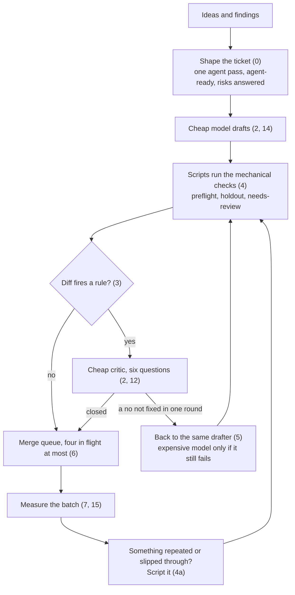

<picture>
  <source media="(prefers-color-scheme: dark)" srcset="assets/logo-dark.svg">
  
</picture>

# Lean agent

Run AI coding agents over a ticket backlog without burning a plan in a night.

[](https://github.com/arnelirobles/lean-agent/releases) [](https://github.com/arnelirobles/lean-agent/actions/workflows/ci.yml) [](LICENSE)

Lean agent is a method and a Claude Code plugin. The method is how I ran agents over my own backlog after burning through a plan in one night in September 2026. The plugin is the part of the method that runs by itself: skills, scripts on the agent's PATH, and hooks that note, and in the strict profile block.

**This release changes the default.** The hooks used to block. They now run in the `standard` profile, which gives a note or says nothing instead of refusing. Three things still block: a real key in a file Claude writes (when the scanner runs), the opt-in `LEAN_LOOKUP_MODE=block` and `LEAN_IMAGE_MODE=block`, and the git hooks you install. Set `LEAN_PROFILE=strict` to get the old blocks back. See [Profiles](#profiles).

The numbers here are mine, at list prices, on one .NET codebase. Treat them as a shape, not a benchmark.

## Quickstart

```bash
claude plugin marketplace add arnelirobles/lean-agent
claude plugin install lean-agent@lean-agent
```

Nothing else is needed. By default (the `standard` profile) the hooks do not refuse your commands for style or workflow: a bad commit message, a direct `npm test` or a sleep loop gets a short note or nothing. Still blocking: a real key or token in a file Claude writes, the opt-in `LEAN_LOOKUP_MODE=block` and `LEAN_IMAGE_MODE=block`, and the git hooks you install. `LEAN_PROFILE=off` turns every hook off.

On a GitHub repository with no brain database and no test queue you can use two skills:

- `/lean-agent:shape-ticket` searches the repository's open issues and pull requests with `gh`, then writes the issue in the agent-ready shape. It needs `gh` logged in and nothing from brain.
- `/lean-agent:adversarial-review` reviews a pull request or branch with a hunting agent and a refuting agent, and reads the repository's own rules first. It uses git and `gh`, runs `tools/style-scan` on a review body, and logs a row to `~/.lean/lean.db`. It does not use brain or the test queue.

## The short version

Shape the ticket for the agent before anyone starts: one ticket is one agent pass, written so the agent needs nothing else, with the review's questions answered in advance. A cheaper model drafts every change, and a fast one finds code and runs the gates. Scripts, not instructions, run the mechanical checks. A cheap critic reviews every change against six fixed questions. The expensive model only sees what the critic cannot close. At most four changes in flight.

That took me from about 13 dollars of model use per change to about 9, with no drop in what got caught. Until 1.4.0 this line said 66 and 25: the cost script counted each message's usage once per transcript row, and its prices were those of older models. [Section 7](https://github.com/arnelirobles/lean-agent/wiki/Measure-Every-Batch) has the correction.



The numbers in brackets are sections of the method. Each one is a page in the [wiki](https://github.com/arnelirobles/lean-agent/wiki/Home).

## Why three models

Each step goes to the cheapest model that can do it without losing a defect.

| Model | Runs | List price per million tokens, in and out |
| --- | --- | --- |
| Haiku (fast) | finding code, running the gates and pasting their output, collecting the retro's numbers | 0.10 and 0.50 |
| Sonnet (cheap) | spec review, every draft, the critic's hunt and refute, the first fix round | 2 and 10 |
| Opus (strong) | a finding not fixed in one round, an unsure answer on core code | 4 and 20 |

Haiku is 20 times cheaper than Sonnet and faster, so work that only reads and reports costs almost nothing. It never answers a yes or no about code. A small model that wrongly throws out a finding drops a real defect with no trace, so the critic stays on Sonnet.

What this saves depends on how much of a change's cost was searching and running scripts. Most of it is the draft and the critic, which do not move. The Haiku split has not been measured on a batch yet. Run `lean-stats report` after one: it prints cost by role, and `search`, `gate` and `retro` are the Haiku roles. If they stay under a few percent of the spend, the saving is small and `LEAN_MODEL_FAST=sonnet` changes nothing that matters.

`lean-stats` collects on its own: when a session ends, the SessionEnd hook starts `lean-stats collect --transcript` for that session and its subagents in the background. It never blocks the hook, and `LEAN_STATS=off` stops it. Each run stores counts only (no prompt, code or command text): peak context, turns over 80k, read-only lookup calls, image results, errored tool results and wait-loop calls. `lean-stats report` turns them into an Avoidable section. Each signal shows its share of the period's tokens and list price, and Haiku's share of runs is shown against the share of runs the method gives it. A turn counts toward a signal in whole, so the shares overlap and are an upper bound. Lookup calls are the coordinator's on Opus only. The next `lean-stats collect` reads a file again when any of its runs has no signals, so runs from an older lean-stats fill in; until then they are left out, not counted as zero. The fast model row is named after `LEAN_MODEL_FAST`.

While a session runs, a hook tells the coordinator when it is costing the most. Once context passes `LEAN_CONTEXT_WARN` it adds a note on every turn: the size, what the turn costs at list price, the running total since it passed the threshold (a lower bound, since turns without a tool call are not counted), and to `/compact` or file what is open in brain and start a fresh session. After `LEAN_LOOKUP_WARN` read-only lookups by an Opus coordinator in one session it adds one note to send them to `lean:search` on the fast model. Above `LEAN_IMAGE_CONTEXT` tokens it adds one note per turn after an image result (a Read of a png, jpg, jpeg, gif or webp file or of a pdf with `pages`, or a tool with `screenshot` or `thumbnail` in its name). Subagents never get a note or a refusal. Notes block nothing. Two settings turn them into refusals (exit 2 from a PreToolUse hook): `LEAN_LOOKUP_MODE=block` refuses the next Grep, Glob or Bash grep, rg, find or cat once an Opus coordinator has made more than `LEAN_LOOKUP_WARN` lookups since it last started an Agent. Read, ls and git or gh state checks count but are never refused, since an Edit needs a Read first and a state check is not a search. Starting an Agent resets that count; the note mode's count is per session and its note fires once, and `LEAN_IMAGE_MODE=block` refuses the image tools above `LEAN_IMAGE_CONTEXT`. Only searches already counted as read-only lookups can be refused, never a Read, a state check or a write. The counters live in `~/.lean/context-cost` (next to the database, private to you) and stay when a session is resumed, so a resumed session keeps its lookup count and does not repeat what it was told.

## Install

```bash
claude plugin marketplace add arnelirobles/lean-agent
claude plugin install lean-agent@lean-agent
```

Update with `claude plugin update lean-agent@lean-agent`. Claude Code picks up a change only when the plugin version moves. More in [Installation](https://github.com/arnelirobles/lean-agent/wiki/Installation).

## What you get

| Part | What it does | Reference |
| --- | --- | --- |
| `method` skill | The condensed rules. The agent loads it when it plans, files, reviews or finishes a batch. You do not call it. | [The cascade](https://github.com/arnelirobles/lean-agent/wiki/The-Cascade) |
| `/lean-agent:shape-ticket` | Writes an issue in the agent-ready shape, after searching for one it belongs to. | [Shape the ticket](https://github.com/arnelirobles/lean-agent/wiki/Shape-the-Ticket) |
| `/lean-agent:adversarial-review` | The critic: one agent hunts, a second tries to refute. | [Adversarial critic](https://github.com/arnelirobles/lean-agent/wiki/Adversarial-Critic) |
| `/lean-agent:lean-retro` | The retro that changes the method from numbers. | [Self-improving retro](https://github.com/arnelirobles/lean-agent/wiki/Self-Improving-Retro) |
| Scripts in `tools/` | Preflight, holdout, needs-review, cost, hygiene and more. Each has a `--self-test`. Holdout claims one hunk per binding (edits with no context between them count separately), uses `HOLDOUT_BASE` or the remote default branch, treats every changed file that is not a test, doc or lockfile as production, and takes space-separated `HOLDOUT_PRODUCTION` and `HOLDOUT_NOT_PRODUCTION` globs. | [Scripts](https://github.com/arnelirobles/lean-agent/wiki/Scripts) |
| `test-phase` | Drains the test queue in brain through `heavy.sh` with a stall watchdog, one drainer at a time. Takes a plan file too (one project per line). Sorts failures into flaky and real, logs every command as a run, and writes the failures to brain. | [The cycle](#the-cycle) |
| `brain` | A local SQLite list of open failures, deferred minors, questions, blockers, running agents and next steps, plus the test queue, with tags, runs and stats. `brain resume` prints what is open for a project, and `brain digest` a 2 KB summary of it (counts, blockers, questions, running jobs, stale agents). | [The cycle](#the-cycle) |
| `brain-mcp` | An MCP server (the plugin registers it as `brain`) that gives a session eleven tools over the brain database: `brain_list` (open items, newest first, 50 lines unless `limit` says otherwise), `brain_show`, `brain_add`, `brain_close`, `brain_queue_list` (queued and running unless `status` says otherwise), `brain_queue_add`, `brain_queue_cancel`, `brain_queue_bump`, `brain_queue_route`, `brain_digest` and `brain_stats`. It runs the `brain` CLI, sends a body on stdin, and does not expose `queue next` or `queue finish`, which only the drainer uses. | [The cycle](#the-cycle) |
| `vscode/` | The Lean Brain VS Code extension: a read-only dashboard, status bar and trees over the brain database. Build it with `npm run package` in `vscode/`. | [vscode/README.md](vscode/README.md) |
| Hooks | In the `strict` profile these block (attribution and slop in public text, a bad commit author, files in a scratchpad root, background shells, sleep loops, direct test runs, keys and tokens in a commit, push or written file); in `standard` only a key in a written file blocks. The rest add a note and never stop the call. One of them hands the session a brain digest for its project at startup and after a compaction. Each has an off switch. | [Hooks](https://github.com/arnelirobles/lean-agent/wiki/Hooks) |
| `lean-stats` | One local SQLite file of tokens, reviews, merges and hook fires. Nothing leaves the machine. | [Measure every batch](https://github.com/arnelirobles/lean-agent/wiki/Measure-Every-Batch) |

Everything in the method still works without the plugin. Without it, run the scripts from `tools/` (for example `tools/holdout.sh`).

## The cycle

Code everything first, with builds only. Then run one test phase, load balanced. Failures go to brain. Then one fix round.

```bash
brain queue add ~/repos/app tests/App.Tests/App.Tests.csproj --cycle c1 --by me   # prints the job id
brain queue add ~/repos/app tests/Api.Tests/Api.Tests.csproj --after 1 --cycle c1
test-phase                     # drains the queue; start it once, as a background task
test-phase plan.txt            # same, after enqueuing the plan (<repo-dir> <test project path> [fast-filter])
brain list --cycle c1          # what the phase found
brain list --open              # what the fix round works from
brain close 12 --resolution fixed --commit abc1234
test-phase                     # again, to see the list empty
brain stats                    # flaky rate, lane wait and duration per test project
```

The scripts live in the plugin's `tools/` directory. At session start the plugin appends that folder to `PATH` in `$CLAUDE_ENV_FILE`, once per session (a resume after an upgrade adds the new version's folder), so a bare `brain` or `test-phase` works in the session's shell and the hooks' notes use bare names. PowerShell reads the file only when every line is a plain assignment, so a PowerShell command loses the `LEAN_SESSION_*` variables because of the PATH line. Where `CLAUDE_ENV_FILE` is not set, the notes keep the absolute path, and in a skill or hook you can call `${CLAUDE_PLUGIN_ROOT}/tools/brain list`. In your own shell, put the folder on `PATH` in your profile, for example `export PATH="$(ls -d ~/.claude/plugins/*/lean-agent/lean-agent/*/tools | sort -V | tail -1):$PATH"` (it picks the newest installed version each time a shell starts), or symlink the tools you use into a folder already on `PATH`.

Upgrading from 1.15.0 or earlier: `bin/` is gone. Anything you scripted against `bin/<name>`, or against the old bare names that Claude Code put on PATH, needs the `tools/` path. Permission allow rules that name a bare tool, such as `Bash(brain:*)`, stop matching and need the tools path. The brain MCP server and the hooks move on their own.

Nobody waits in a loop. A session adds jobs with `brain queue add` (it returns at once) and ends its turn. The orchestrator starts one `test-phase` as a background task and gets one notice when it exits. `test-phase` takes the oldest job whose `--after` job is done, runs it, records the run and the failures, and repeats until nothing is ready. A second `test-phase` while one drains says so and exits 0. A job whose dependency failed or was cancelled is cancelled with the reason. `brain queue list` and `brain resume` show queued and running jobs; `brain queue cancel ID` drops a queued one. `brain queue bump ID` moves a queued job, and the queued jobs chained after it with `--after`, to the front; the last one bumped runs first, and the list marks bumped jobs `bumped`. `brain queue move ID up` or `down` swaps a queued job with its neighbour in run order, and refuses to put a job ahead of the job it waits on. `brain queue list --status queued` lists jobs in the order they will run. Adding a job that is already queued (same folder, project, filter, tier, `--after` and arguments) prints the queued job's id instead of adding a second, so agents that ask for the same run share one build. A fast filter can name several classes joined by `|`, for example `--filter 'OrderTests|InvoiceTests'`; test-phase passes one `--filter-class` per class under MTP (xunit v3 runs the union of repeated ones) and one `FullyQualifiedName~` term per class under VSTest. Under MTP it then lists each class alone, and a class that matches no test fails the job and is named, since the union hides it while another class matches.

Gradle: a test path that is a `settings.gradle.kts` or `settings.gradle`, or the folder holding one, is a Gradle job (named by its folder). `test-phase` runs only the repo's own `./gradlew` with `--console=plain --continue --no-daemon`, default task `check`; `--args="jvmTest iosSimulatorArm64Test"` names other tasks. `--rerun` follows every test task so an unchanged tree still runs its tests, and the fast filter becomes `--tests` on each test task. A rerun of a failed class uses the task that wrote its results, even under `check`. Only task names and these options are accepted in `--args`: `--tests`, `-x`, `--rerun`, `--rerun-tasks`, `--info`, `--warn`, `--quiet`, `--stacktrace`, `--offline`, `--continue`, `--dry-run`, `--max-workers`, `--warning-mode`, `--build-cache`, `--parallel`, `--fail-fast` and `--refresh-dependencies`; `-P`, `-D`, `-I`, `-g`, `-c`, `-b`, `--include-build` and the rest are refused. The child gets an allowlisted environment (PATH, HOME, USER, JAVA_HOME, ANDROID_*, LC_*, GRADLE_OPTS and JAVA_OPTS without `-Dorg.gradle.project.*`, and a few more), so tokens, passwords and signing keys in the shell never reach the build. Results come from `build/test-results/**/TEST-*.xml` written during the run. A run with no passed or failed test is reported as `ran-no-tests` (skipped tests do not count; a test task that Gradle reports UP-TO-DATE or FROM-CACHE keeps its earlier results, which are read as they are), and a failing non-test task is a `run-failed` item that names it. Any output line counts as progress, and a Gradle job's default stall is 3600 s (`--stall` or `TEST_PHASE_STALL` overrides it). The job stays on the local lane (`route --to remote|any` and `--platform none` are refused), and an iOS test task makes it Apple-only. Gradle still reads `~/.gradle/gradle.properties` and `~/.gradle/init.d` on the local lane, so signing keys belong only in the environment of the publish script.

Remote lanes: list SSH hosts in `~/.config/lean/remotes.ini` and `test-phase` runs one job per host at the same time as the local lane, in a capped docker container on the host. Apple-platform test projects and npm projects with a private registry in `.npmrc` stay local. A lost connection puts the job back in the queue, not in brain as a failure. The host keeps one build folder per repository, commit, hash of the copied files and contents, image and build arguments: the first job on that key copies and builds, later jobs skip both and run `dotnet test --no-build` there, and a new commit or any changed file builds again. The newest 3 folders per repository stay (`build_keep`); `reuse_build = no` in the `[remote ...]` section goes back to a fresh folder and build per job. Setup, the copy rules and cleanup are in [docs/remote-lane.md](docs/remote-lane.md).

Activity from other tools, such as BaryoVM, goes into brain with `brain activity add` or `brain activity import-baryovm`, and shows on the dashboard Activity tab. Commands and the line format are in [docs/activity.md](docs/activity.md).

`test-phase` runs every command in the `dotnet` lane of `heavy.sh`, so sessions on one machine take turns instead of loading Docker together. It stops a command that shows no test progress for `HEAVY_STALL` seconds (exit 76, "likely load, not code"). Progress is a Microsoft Testing Platform counter line (`[+passed/xfailed/?skipped]`) whose counts changed, or a passed or failed result line, so a repeating counter where only the elapsed time moves does not count. It reruns each failing class alone, and labels the test flaky if it passes alone and real if it fails again. Ask whether a lane is free with `heavy.sh status dotnet`, never with a `pgrep` loop: the loop matches its own command line and never ends.

A job holds its lane from its full run to its last rerun. A command ended by a signal is recorded as killed, files nothing, and the job is queued once more. A run that adds only failures for `--fail-stall` seconds (default 1200) is stopped as stalled-failing (exit 78). Stall notes carry the passed and failed counts and the last test seen. A local .NET run also gets a hang timeout 60 s under `--stall` (half of it when `--stall` is short), so the test host names the tests still running before `heavy.sh` stops it: `--blame-hang-timeout` on VSTest, `--hangdump --hangdump-timeout` on Microsoft.Testing.Platform. The MTP flags are added only when the project file, a `Directory.Build.props` or `.targets` above it, or a `Directory.Packages.props` above it has a `PackageReference` or `PackageVersion` whose name contains `HangDump`, or sets a `HangDump` property to true; a comment or other text mentioning it does not count. The VSTest hang timeout is per test, so a single test that runs longer than it is dumped and the host is killed, even while other tests pass. To make the hang timer and the stall clock start together, the project is built first (`dotnet build`) and the tests run with `--no-build`. If the extra arguments already set `--results-directory`, a logger, a collector, `--settings`, `--blame` or `--diag`, or include an argument `dotnet build` does not take, the hang arguments are left off and the stall note says so. VSTest hang detection was checked against a real hang (SDK 10.0.103: the Sequence file and a mini dump land in a GUID subfolder of the results folder, and the output also says the host crashed, which does not stop it being read as a hang). Microsoft.Testing.Platform hang detection is unverified: with xunit.v3 3.0.0 and HangDump 1.8.0 the extension never fired in a 200 s capture at a 30 s timeout, so the MTP output format is a guess, and the MTP hang arguments go before `--` because the SDK rejected `--results-directory` after it. A run counts as a hang only when the hang timer fired (a dump file in the results folder, or the hang line in the output); a crash that leaves a Sequence file is a crash. A hung run is recorded as stalled even when its exit code is 1. A failing class that hangs when rerun alone is filed as a hang and its failures are unverified, not flaky. Each named test is filed as a `test-fail` tagged `hang` that says it hung, instead of a `stalled:` note. A test that hangs on a second run is also tagged `hang-repeat`: that is a hang, not load. The dump is written under the run's log directory and deleted once the names are read. When no name is found (no package, a remote lane, `TEST_PHASE_HANGDUMP=off`, a dump with no names) the `stalled:` note stays and says why. When more than `--isolation-over` tests (default 10) fail in one run and all pass alone, one `isolation` item lists them instead of flaky items. A test that fails in a full run and passes alone again on the same branch and test project becomes a test-fail tagged `order-dependent`. `brain flaky-clear` closes a flaky item with no new occurrence in 5 passing unfiltered full runs of its test project as `flaky-cleared` (runs carry no branch); a passing full run calls it. A job killed twice fails with a `killed twice` note.

A rerun is flaky only when it exits 0 or passes tests without the name; a rerun that proves nothing is unverified. A job whose failures are all flaky finishes done, so its dependents run. Extra dotnet arguments come from `TEST_PHASE_DOTNET_ARGS`, an `args=EXTRA` field on a plan line or `brain queue add --args=EXTRA`, for example `-p:ValidateXcodeVersion=false` for Mac Catalyst desktop tests. The brain project of a job is the main repository's name, so worktrees share it. Secrets in test output (passwords, bearer tokens, JWTs, api keys) are masked before they reach brain.

Test prerequisites: a repository can list what its tests need in `.lean/test-needs`, one per line: `docker` (the daemon answers `docker info`), `path ../sibling` (a folder or file exists, relative to the main checkout, the folder holding `.git`, so a worktree job looks in the same place), `env NAME` (set and not empty; the value is never printed), `command NAME` with an optional `gnu` or `>=22.11` (on PATH, and `NAME --version` says GNU or is at least that). `#` starts a comment, also at the end of a line, and an unknown line counts as a missing prerequisite. Before a local job starts, `test-phase` checks the list and runs `check-runtime.sh` on the repository (`--doctor` does the same, and both skip everything when the file is absent). If anything is missing the job fails with each missing piece named, a `blocker` item goes to brain, and no test runs, so nothing lands as a `test-fail`. `test-phase --doctor [DIR]` runs the same checks alone and exits 1 when something is missing. A later passing full run of that test project closes the blocker. Nothing is installed. Remote lanes skip the check, since the files and variables it reads belong to this machine. Without a `.lean/test-needs` file nothing is checked before a run.

Environmental runs: when at least 3 failures in a run, and more than half of them, come from the machine (`DockerUnavailableException`, the Testcontainers `ResourceReaper` failing to start, Npgsql `Failed to connect to`; the causes are added together), `test-phase` files one `blocker` for the run with a count per cause instead of one `test-fail` per test. Those tests are not rerun, so none of them can become a flaky item. A run of 1,800 Docker failures is one blocker and no `test-fail` items. Other failures in the same run are filed as unverified and worded as not rerun. A remote lane rests after such a run, like after any lane problem. A passing full run closes the blocker.

Waiting without polling. `brain queue wait ID...` blocks until every named job ends and prints one line per job: id, status, passed and failed of its run, and the brain item ids the run filed. It exits 0 when all are done, 1 when any failed or was cancelled, 2 for an unknown id and 3 on `--timeout` (default 7200 seconds), printing each job still pending and its state, so a job no lane ever took shows as `queued`. It reads the database every 15 seconds (`--interval`). `pr-wait <pr> [--repo R]` does the same for a pull request's checks: exit 0 and one line when green, 1 with the failed check names and the last 40 lines of each log (after any known environmental cause why-red.sh finds) when red, 3 on timeout. `pr-wait --provider azure <run id> --org O --project P` waits for one Azure Pipelines run. Without `--provider` it follows the origin URL of the current folder, and GitHub when that says nothing. On an Azure origin the target is a pipeline run id, not a pull request, and the first output line says which provider and target it is waiting on. Zero checks reported yet (right after a push) counts as pending, a poll that fails is retried until the timeout (the last error goes in the timeout line) or until `--max-errors` polls fail in a row (default 5, exit 2), and a check or run that ends in anything but success, `partiallySucceeded` included, counts as failed. A failed check with no Actions log prints its link. `--interval` and `--timeout` are at least 1 second. A timeline or log call that az refuses prints its exit code and first stderr line to stderr, and the Azure log fetch (`az devops invoke --out-file`) is unverified against a live Azure DevOps organization. Start either with run_in_background and end the turn.

Adding a pr-wait provider. A provider is one class in `lib/forge.py` with `label`, `checks()` (one CLI call, returns checks with a `name` and a `state` of `pass`, `fail` or `pending`) and `failed_log(check, tail)`, taking its CLI options in the constructor and a `capture(argv)` function for the CLI call. Register it in `CI_PROVIDERS` under the name `kind_of` returns, and add `<name>_ci_test` next to `github_ci_test` in the same file: a fake CLI in a temp folder on PATH, no network, and a check that the other providers' tools are never called. The interface is written out in the `forge.py` docstring.

Known limits:

- The watchdog's orphan cleanup records a process group only when `HEAVY_STALL` is on, so a killed caller without the watchdog leaves its command running.
- A rerun runs a whole class, so one flaky test in a large class costs the class's runtime.
- The drainer's options (`--stall`, `--lane`, `--cycle`) apply to every job it drains, including jobs queued by others.
- A job left `running` by a drainer that died is only cleaned up when the next drainer starts.

What goes where:

- brain holds anything whose status changes: test failures, flaky classes, deferred minors, open questions for the user, unfiled or filed tickets, security findings, blockers, running agents, next steps.
- Markdown ledgers keep rulings (decisions, with the cost if wrong), task complete lines and user decisions. A ledger points to open items with a line like `open items: brain list --project X --status open`.
- Memory files keep standing preferences.
- Run logs are scratch. They can expire once their failures are in brain.

Brain never holds secrets, tokens or passwords.

brain's code lives in `lib/brain/`, and `tools/brain` only starts it. Reads of merged pull requests (`lean-stats collect` and `retro-signals.sh`) go through `lib/forge.py`, which supports GitHub; GitLab and Azure DevOps come with tracker support. `lean-stats collect` also counts merged Azure DevOps pull requests through `az` (they are stored as `ORG/PROJECT/REPO`), for the Azure repositories your transcripts already name. Naming repositories on the command line collects only those, and a line says when Azure ones were skipped. Fix rounds, failed checks and escaped refs stay empty for Azure rows. `forge.py` can also count the commits on an Azure pull request, but nothing calls it yet. Once a day `collect` rewrites old `_git/NAME` and `org/project` repo names to `ORG/PROJECT/REPO` from what `az repos list` shows for your default organization, so cost joins the changes. A three-part name counts as Azure only when its organization is your az default or one seen in an Azure remote.

## Brain page

`brain serve` serves a page over the brain database at `http://leanagent.localhost:8770` (also `http://127.0.0.1:8770`, printed at start). Use `--port N` or `LEAN_SERVE_PORT` for another port. It listens on 127.0.0.1 only and accepts only the Host values `leanagent.localhost`, `localhost`, `127.0.0.1` and `[::1]`. Chrome, Edge and Firefox send `*.localhost` to your machine with no setup. The plugin never edits your hosts file.

The page is meant for a single-user machine. Another local user who takes port 8770 before you could serve a fake page, and the server does not guard against that.

Three modes, set with the plugin's `serve_mode` setting:

- `manual` (default): you run `brain serve` yourself.
- `session`: the SessionStart hook starts the server when a session opens. It stops after 30 minutes with no open session. A session that started more than 12 hours ago and never closed does not count as open.
- `always`: the server starts at login. Run `brain serve --install always` once to write the login entry: a launchd agent on macOS, a systemd user unit on Linux, or a Startup folder `.cmd` on Windows. No admin rights. Until that entry exists, the SessionStart hook starts the server when a session opens and leaves it running. `brain serve --uninstall` removes the entry.

`worktree_roots` is a comma-separated list of folders the page searches for git worktrees, besides the repositories brain already knows. `brain serve --roots A,B` does the same for one run.

The session button on an item starts Claude Code on it. On macOS it opens Terminal. On Windows it opens a Windows Terminal tab; if that fails, or `claude` is a `.cmd` shim, the page shows the command to copy, with a note to paste it into Command Prompt. On Linux the page shows the `claude` command to copy.

The VS Code panel is deprecated. It shows a notice once per version and `Lean Brain: Open brain page` opens the page.

## Settings

Set these in the `env` block of your Claude Code settings. The defaults run the method as written.

| Variable | Default | Effect |
| --- | --- | --- |
| `LEAN_PROFILE` | `standard` | `strict` keeps every block. `off` turns every hook off. An unknown value counts as strict. See [Profiles](#profiles). |
| `LEAN_AGENTS` | `many` | `one` runs everything in one session: no subagents, one ticket at a time. |
| `LEAN_MODELS` | `mixed` | `one` keeps every step on the session's model: no cheap drafter, no escalation. |
| `LEAN_MODEL_CHEAP` | `sonnet` | The model that drafts and critiques. |
| `LEAN_MODEL_STRONG` | `opus` | The model that takes what the cheap steps could not close. |
| `LEAN_MODEL_FAST` | `haiku` | The model for agents that read and report: code search, running the gates, the retro's fact collection. It never judges code. |
| `LEAN_STATS` | on | `off` stops every `lean-stats` write. |
| `LEAN_CONTEXT_WARN` | `100000` | Context size, in tokens, where the coordinator gets a cost note. `off` turns it off. |
| `LEAN_LOOKUP_WARN` | `10` | Read-only lookups by an Opus coordinator before it is told to use `lean:search`, or refused with `LEAN_LOOKUP_MODE=block`. `off` turns both off. |
| `LEAN_LOOKUP_MODE` | `note` | `block` refuses the next Grep, Glob or read-only Bash search (never Read) of an Opus coordinator past `LEAN_LOOKUP_WARN` since its last Agent start, naming `lean:search`. |
| `LEAN_IMAGE_CONTEXT` | `60000` | Context size, in tokens, above which an image result is noted, or refused with `LEAN_IMAGE_MODE=block`. `off` turns both off. |
| `LEAN_IMAGE_MODE` | `note` | `block` refuses tools that return an image (Read of an image file or a pdf with pages, screenshot and thumbnail tools) above `LEAN_IMAGE_CONTEXT`, so a subagent looks and reports in text. |
| `LEAN_BRAIN_DB` | `~/.local/share/lean/brain.db` | Where `brain` keeps its database. |
| `LEAN_BRAIN_RESUME` | on | `off` stops the startup hook from printing the brain digest. |
| `LEAN_SKIP_SECRET_SCAN` | off | `1` turns off `secret-scan`, the Claude hook and the git hooks it installs, in every profile. A line with `allow-secret` on it is skipped without this. |
| `LEAN_SCRIPT_NOTE` | on | `off` stops the note that names the script behind a hand-written command. |
| `LEAN_DIRECT_TEST` | block in `strict`, nothing in `standard` | `allow` stops the block on a direct `dotnet test`, `npm test`, `npx vitest` or `vitest run` where test-phase can take the job. Tests go through `brain queue add` and `test-phase`. A `package.json` that uses jest and not vitest is left alone, and so is a `pnpm -r`, `--filter`, `turbo` or `nx` script, since the queue has no jest runner. |
| `LEAN_NPM_REGISTRY` | `npm config get registry`, else `https://registry.npmjs.org` | The npm registry `pkg-version` asks. |
| `LEAN_NUGET_REGISTRY` | `https://api.nuget.org/v3-flatcontainer` | The nuget flat container `pkg-version` asks. |

Every off switch for a hook is in [Settings](https://github.com/arnelirobles/lean-agent/wiki/Settings).

## Profiles

`LEAN_PROFILE` goes in the `env` block of Claude Code settings, like the other settings. It is read case-insensitively and trimmed. Unset means `standard`. A value that is not `strict`, `standard` or `off` counts as `strict`, so a typo never loosens a check, and the session start note warns about it.

- `strict`: every check blocks, as before this release.
- `standard`: a check that was a matter of taste or of this workflow gives a note or says nothing. A key in a written file still blocks.
- `off`: every hook exits at once, before it reads the event, so nothing is read, written or started. Skills, scripts, brain and the MCP server are not hooks and stay.

| Check | `strict` | `standard` |
| --- | --- | --- |
| public text: attribution, slop, dashes, arrows | blocks | note |
| commit author email | blocks | note |
| scratchpad root file names | blocks | nothing |
| background shell without `bounded` | blocks | nothing |
| sleep loops, `pgrep` waits | blocks | note |
| `gh pr ready` or `merge` with no logged review | blocks | nothing |
| direct `dotnet test`, `npm test`, `vitest` where `test-phase` can take it | blocks | nothing |
| a key or token in a Write, Edit, MultiEdit or NotebookEdit (scanner runs) | blocks | blocks |
| a commit or push that turns the git hooks off | blocks | note |
| a commit or push in a repository without the git hooks | blocks | note |
| `git init` or `clone` and a commit in one command | blocks | nothing |
| a commit in a repository the hook cannot determine | blocks | nothing |
| the secret scan hook crashed or is missing, Bash command | blocks | nothing |
| the secret scan hook crashed or is missing, Write or Edit | blocks | note (the key scan did not run) |
| `LEAN_LOOKUP_MODE=block`, `LEAN_IMAGE_MODE=block` | refuses | refuses |

The explicit settings win in every profile: `LEAN_ALLOW_*`, `LEAN_SKIP_*`, `LEAN_DIRECT_TEST=allow` and the other off switches behave as before. The two opt-in refusals keep refusing under `standard` because you asked for them.

A direct test run gets no wait-loop note under `standard` either, unless `LEAN_DIRECT_TEST=allow` is set, which is the one case that note already covered.

The git hooks that `secret-scan install` writes do not read `LEAN_PROFILE`. A person has them only after running install, so they keep blocking a key in a commit or push in every profile. `LEAN_SKIP_SECRET_SCAN=1` or an `allow-secret` line is how to get past them.

## Keep keys out of git

The scan runs in git's own pre-commit and pre-push hooks, so a commit or push is checked however it is made: by Claude, by you in a terminal, through an alias, with a pathspec or `-a`. Install them per repository:

```
secret-scan install [REPO]       pre-commit and pre-push in one repo
secret-scan install --force-shared  also when the hooks folder is shared
secret-scan install --all DIR    every git repo under DIR
secret-scan uninstall [REPO]     (or --all DIR) take them out
secret-scan status [REPO]        are the hooks working, is the scanner copy current
```

pre-commit checks the lines the commit adds, from the index git is about to commit. pre-push checks the commits the push sends that the target remote does not have, merges included (what a conflict resolution adds), and a tag that points at a blob or a tree. A commit that sits only on another remote is checked again on its way to a new one, unless that other remote is public (an anonymous `git ls-remote` over https works), so a fork of a public repo does not rescan its history. The edge of a shallow clone counts as already known. Diffs are read as text even when `.gitattributes` or config marks a file binary; a file's text ends at its first NUL byte.

The patterns: Google `AIza`, GitHub `ghp_`/`gho_`/`ghu_`/`ghs_`/`ghr_`/`github_pat_`, AWS `AKIA`, Slack `xox`, Stripe `sk_live_`/`rk_live_`, npm `npm_`, Anthropic `sk-ant-`, OpenAI `sk-proj-`/`sk-svcacct-` and the classic 48-character `sk-`, GitLab `glpat-`, Hugging Face `hf_`, SendGrid `SG.`, Groq `gsk_`, private key blocks, and an Azure DevOps PAT when it sits next to a name like `token` or `pat`. When `gitleaks` is on PATH its rules run as well, once per scan, with a time limit (`LEAN_SECRET_SCAN_TIMEOUT`, 20 seconds), and not at all for a scan over 8 MB. If it is skipped, fails or times out the hook prints a warning and the pattern result stands. The output names the file, line and pattern, never the value. A line with `allow-secret` on it is skipped, that line only. Git runs with fsmonitor, textconv, external diff, signature checks and clean filters off, so a repository's own config cannot run code during the scan.

The `secret-scan` Claude hook does not scan commits. Before a Bash command that commits or pushes (including an alias, a git command it does not know, and calls inside `bash -c`, `eval`, braces, `if` and `xargs`), it checks that the repository has both git hooks and the scanner copy they run, and, in the `strict` profile, blocks with the install command when not (`standard` gives a note with the install command). It also blocks a command that skips them in `strict` (a note in `standard`): `--no-verify`, `commit -n`, `core.hooksPath`, `include.path` or `includeIf` set with `-c`, `--config-env` or `git config`, `GIT_CONFIG_*`, `HOME` or `XDG_CONFIG_HOME` set in the command, and `git send-pack`. Git commands that run other commands count as a commit, and the command they run is checked for the same flags: `submodule foreach`, `rebase --exec` and `-x`, `bisect run`, `filter-branch` (`--env-filter`, `--tree-filter`, `--index-filter`, `--parent-filter`, `--msg-filter`, `--commit-filter`, `--tag-name-filter`, `--setup`), `difftool` and `mergetool` (`-x`, `--extcmd`), and `for-each-repo` (its arguments are read as a git command). A `$( )` or backtick substitution is read too, also inside double quotes (a heredoc inside it is cut out first). Some external commands pass only in read-only forms: `lfs` (pull, fetch, install, update, prune, version, ls-files, status, track, but not with `--force`), `svn` (log, fetch, rebase, info, clone), `p4` (sync, clone), `machete` (status, discover), `flow` (init, start, list). The rest of `lfs`, `svn`, `p4`, `machete` and `flow`, and `absorb`, `send-email`, `gui`, `citool`, `filter-repo`, `fast-import`, `subtree` and unknown commands, need the hooks, like commit. `request-pull`, `instaweb`, `daemon`, `scalar`, `delta`, `last-modified`, `update-server-info`, `sh-setup` and `quiltimport` pass. A command that never says `git` is checked when a variable that looks like git (`$GIT`, `${G}`) is followed by `commit` or `push`. When the folder is a variable, a command or a cd target that does not exist yet, it checks the starting repository, and blocks when that is not one. Write, Edit, MultiEdit and NotebookEdit are scanned directly when the file is tracked or would be (a gitignored `.env.local` and files inside `.git` are fine). A key blocks in every profile while the scanner runs; if it crashed or is missing, standard gives a note that the scan did not run. A block in a repo whose hooks folder is shared or tracked (husky, any `core.hooksPath`) names `--force-shared`. A hook that was edited after install does not count as installed. Every block is a `hook_fires` row in `lean.db`.

An existing hook is kept and still runs after the scan, and a `core.hooksPath` for that repo is respected. The hooks call the python that ran `install` by its full path (python3 from PATH if that file is gone). If a framework overwrites the hook after it was chained, `install` again chains the new hook and moves the older chained one to `<hook>.pre-secret-scan.bak001` (older ones move up to `.bak002` and so on); the chained hook runs first, then `.bak001`, `.bak002` and the rest, newest to oldest, so every foreign hook still runs. Uninstall puts the chained hook back and lists the `.bak` files it leaves. A hooks path that is tracked inside the work tree, or set in global, system or command-line config, is shared by other people or repos, so install refuses it unless you pass `--force-shared`. Uninstall keeps a hook you edited and says so, reports a leftover `.pre-secret-scan`, and says when there was nothing to remove. The scan exits 0 clean, 1 on a finding and 2 when it could not run (a git error, a bad range); the git hooks block on both. Install copies the scanner to `~/.local/share/lean/secret-scan`, so the hooks keep working after a plugin upgrade; if that copy is gone the hooks block and say to run `install` again. The copy carries a scanner rev; a hook check replaces a copy with a lower rev (or none) from the plugin, atomically, and never replaces a copy with a higher rev, so an older plugin cannot downgrade it. A copy with the same rev but other bytes counts as stale. A copy that is unreadable, or lower and outside the scan home, blocks with the `install` command. `secret-scan status [REPO]` says whether the hooks work and whether the copy is current, and exits 1 when not. `LEAN_SKIP_SECRET_SCAN=1` (not `SKIP`, which belongs to other tools) skips the git hooks and the Claude hook.

Not covered:

- the commit message and the command text
- variable flags and options that are not expanded: `$g -c core.hooksPath=... commit`, `a=-n; git commit $a`
- a substitution inside double quotes nested more than three deep
- `git lfs install` in a repo with our hooks refuses or, with `--force`, replaces our pre-push hook; the Claude hook then blocks pushes (in `strict`; `standard` notes it) until `secret-scan install` runs again
- anything after the first NUL in a file
- commits made by `rebase`, `cherry-pick`, `am`, `stash` and `merge`, which do not run pre-commit (the push check gates them)
- the changes inside the commits at a shallow clone's edge, and an edited `.git/shallow`
- a hand-made `refs/remotes` ref, which makes the push scan skip a commit
- hooks turned off outside the command (an exported variable from an earlier command, a global config edited by hand), which the Claude hook cannot see
- tampering with the hook, the scanner copy or `core.hooksPath` inside the same command as the commit
- a commit made outside Claude with `--no-verify`
- `gh repo sync`, `gh api` contents PUT, and `gh pr create --body` holding a key
- libgit2 and scripts that call git
- the public-remote check contacts whatever host a remote URL names, and needs the network; when it fails the other remote counts as private and the commits are scanned

## The method

| Section | Page | In one line |
| --- | --- | --- |
| 0 | [Shape the ticket for the agent](https://github.com/arnelirobles/lean-agent/wiki/Shape-the-Ticket) | Write each ticket so one agent pass finishes it with nothing else to read. |
| 1 | [Triage inline, no agents](https://github.com/arnelirobles/lean-agent/wiki/Triage) | Sort the backlog yourself into three tiers and do tier 0 by hand. |
| 2 | [The cascade](https://github.com/arnelirobles/lean-agent/wiki/The-Cascade) | A cheap model drafts, a cheap critic reviews, the strong model sees only what stays open. |
| 3 | [The diff decides whether a critic runs](https://github.com/arnelirobles/lean-agent/wiki/When-the-Critic-Runs) | Rules over the diff, not the ticket title, decide whether a critic runs. |
| 4 to 4a | [Scripts, not instructions](https://github.com/arnelirobles/lean-agent/wiki/Scripts-Not-Instructions) | Mechanical checks live in scripts. Reasoning an agent does twice becomes a script. |
| 5 to 6 | [Rework and concurrency](https://github.com/arnelirobles/lean-agent/wiki/Rework-and-Concurrency) | Fixes go back to the agent that wrote the change. At most four changes in flight. |
| 7 | [Measure every batch](https://github.com/arnelirobles/lean-agent/wiki/Measure-Every-Batch) | Cost per change and what the critic missed, after every batch. |
| 8 | [Attack your own method](https://github.com/arnelirobles/lean-agent/wiki/Attack-Your-Own-Method) | Test the method against real defects before you trust it. |
| 9 | [Half of what an agent makes is not text](https://github.com/arnelirobles/lean-agent/wiki/Non-Text-Output) | Gate images and other bytes that text checks cannot read. |
| 10 | [A check that passes having checked nothing](https://github.com/arnelirobles/lean-agent/wiki/Checks-That-Check-Nothing) | Make every check fail when it is handed nothing to check. |
| 11 | [The machine has a ceiling too](https://github.com/arnelirobles/lean-agent/wiki/Machine-Ceiling) | Queue heavy commands per toolchain and run agent work at the lowest priority. |
| 12 | [The adversarial critic](https://github.com/arnelirobles/lean-agent/wiki/Adversarial-Critic) | One agent hunts, a second tries to prove each finding wrong. Repository rules first. |
| 13 | [Every finding is an interaction](https://github.com/arnelirobles/lean-agent/wiki/Interaction-Surface) | Look at what the diff touches but did not write, before you push. |
| 14 | [Cheap drafting works, and it stops short](https://github.com/arnelirobles/lean-agent/wiki/Cheap-Drafting) | Where a cheaper drafter holds up and where it stops. |
| 14a to 14h | [Field notes from parallel agents](https://github.com/arnelirobles/lean-agent/wiki/Field-Notes) | Leftover processes, shared scratchpads, wait loops, stacked pull requests, deploys, rehearsals, local CI, steps for a person. |
| 15 | [What a reader should observe](https://github.com/arnelirobles/lean-agent/wiki/What-to-Observe) | The six results to look for, and the two goals that poison themselves. |
| 16 | [The method improves itself](https://github.com/arnelirobles/lean-agent/wiki/Self-Improving-Retro) | A scheduled retro that turns the numbers into changes to the method. |

## Data

lean-agent has no service of its own and keeps nothing off your machine. What it stores stays local: the brain database (`~/.local/share/lean/brain.db`), test-phase logs (`~/.local/share/lean/test-phase`), stats (`~/.lean/lean.db`) and which script notes a session has seen (`~/.local/share/lean/script-note`, deleted after 14 days). The `commit-author` hook reads the git author email to check it and stores nothing. The `secret-scan` git hooks read the lines being committed or pushed and store nothing; the Claude hook reads the text being written and stores only that it blocked. The push check asks a remote's https address, without credentials, whether it is public.

It sends data to other services only through tools you already run, and only where you point them:

- GitHub, through your `gh` login: the adversarial review posts review threads, `lean-stats` and `pr-blockers` read pull requests and checks. The hooks only read the command an agent is about to run; they call nothing.
- GitHub and Azure DevOps, from the brain page, through your own `gh` and `az` logins. The page stores no credentials. A CLI that is missing or logged out shows as such in its section.
- Your own SSH hosts, when `~/.config/lean/remotes.ini` names any: `test-phase` copies the repository there with rsync and runs the tests in Docker. Without that file, no code is copied off the machine.
- A URL you pass to `check-deployed-sha.sh`, which it fetches with curl.
- A package registry, when you run `pkg-version`: it sends the package name to the nuget flat container (api.nuget.org, or `LEAN_NUGET_REGISTRY`) or the npm registry (`LEAN_NPM_REGISTRY`, else your npm config, else registry.npmjs.org). Credentials in a registry URL are dropped before the call.
- Azure DevOps, through your `az` login, when you run `pr-wait --provider azure` or run it in a folder whose origin is Azure DevOps: it reads a pipeline run, its timeline and the failed logs.

## Requirements

- Claude Code with plugin support.
- `python3`, `git` and `gh` on PATH.
- Linux, or macOS with its stock bash 3.2. `heavy.sh` uses util-linux `flock` on Linux. On macOS it takes the lock with python3 and names holders with `lsof`.

## Contributing

A change to `skills/`, `hooks/`, `tools/` or `lib/` moves the version in `.claude-plugin/plugin.json`, and the merge is tagged `v<version>`. `tests/run-all.sh` runs every `--self-test`, lists scripts that have none, and fails when those folders changed since the current version's tag. CI runs it on Ubuntu for every pull request.

A script that works on any repository belongs here, as a pull request with its test and a line on the [Scripts](https://github.com/arnelirobles/lean-agent/wiki/Scripts) page. See [Scripts, not instructions](https://github.com/arnelirobles/lean-agent/wiki/Scripts-Not-Instructions#4a-the-second-time-an-agent-reasons-its-way-through-something-it-becomes-a-script).

## What this does not fix

A backlog with no definition of finished refills faster than it drains. Automation widens the drain. It does not close the tap. Decide what done means first.

## Licence

MIT. Take it, change it, ship it.
